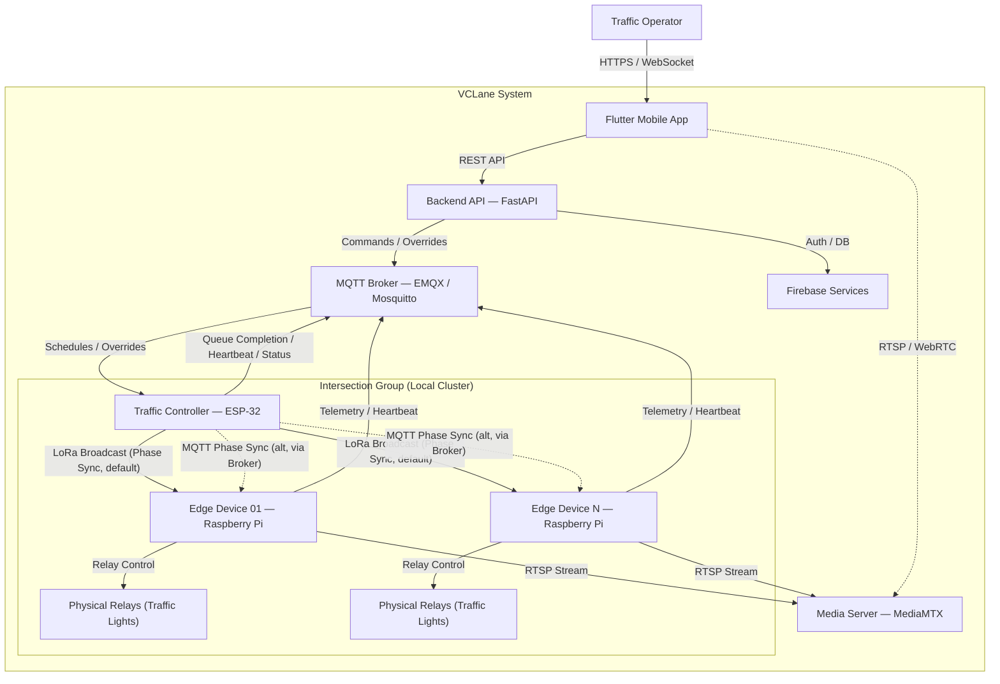

# System Architecture

## Data Flow and Communication Modes

The system operates in two main modes to balance intelligent centralized control with local off-grid resilience:

### 1. Centralized Coordinated Mode (Normal Online Flow)

Under standard operating conditions with active internet connectivity:

- **Schedule and Override Control:** The Backend API publishes per-group configuration (turns-loop schedule, `schedulingMode: fixed | dynamic`, timing plans) and manual overrides to the MQTT broker. The **ESP-32 Traffic Controller** (connected via WiFi) subscribes to these topics, processes the schedules, and runs the local coordination logic — turns-loop round-robin in `fixed` mode, FIFO queue-based on-demand with all-RED idle in `dynamic` mode.
- **Local Broadcast:** The ESP-32 broadcasts the target phase states (e.g., green/red durations for each lane) to the group's **Raspberry Pi Edge Devices** using LoRa by default, or via the MQTT `traffic/group/{groupId}/phase` topic when `sync_transport` is `mqtt`/`dual` (same JSON frame, QoS 1, retained).
- **Actuation:** The Raspberry Pi units receive the phase packets and drive the physical GPIO-connected relays to actuate the traffic signal lamps.
- **Telemetry and Streaming:** The Raspberry Pis process video streams locally, run YOLO inference for traffic analysis, and publish lean status (signal + emergency flag) and device heartbeats via MQTT. In dynamic mode, new `POST /api/devices/{id}/detections` docs trigger the queue: the backend gates on the group's `enqueueEdgeDetections` switch, vehicle allowlist, staleness, RED/CAUTION, and not-already-queued, then forwards `enqueue` to the controller and tracks `has_queued_schedule` in RTDB until completion. An admin can send `forceEnqueue=true` to skip the gate and the group switch. The controller appends every `enqueue` (duplicates included) to its FIFO. They also stream live RTSP video feeds to the Media Server.

### 2. Autonomous Resilient Mode (Offline/Outage Fallback)

In case of connectivity interruptions:

- **Complete Internet Loss:** If the intersection group loses internet connection entirely, the **ESP-32 Traffic Controller** fails over to offline mode. Using its internal battery-backed Real-Time Clock (RTC) and cached schedule, it runs the cached fixed turns loop (even for `dynamic` groups, since server-mediated queueing is unavailable offline) and broadcasts phase assignments via LoRa. The Raspberry Pis continue to receive LoRa signals and actuate the lights, keeping the intersection cluster synchronized. Note: groups running `sync_transport: mqtt` have no offline phase sync — without broker connectivity the edge devices enter caution mode.
- **Edge Device Connection Loss:** If a Raspberry Pi Edge Device loses its internet connection, it is unable to report telemetry to the backend and is marked offline. Telemetry is published exclusively by edge devices — the ESP-32 Traffic Controller does not publish telemetry on their behalf, so an offline edge is simply reported offline until it reconnects.
