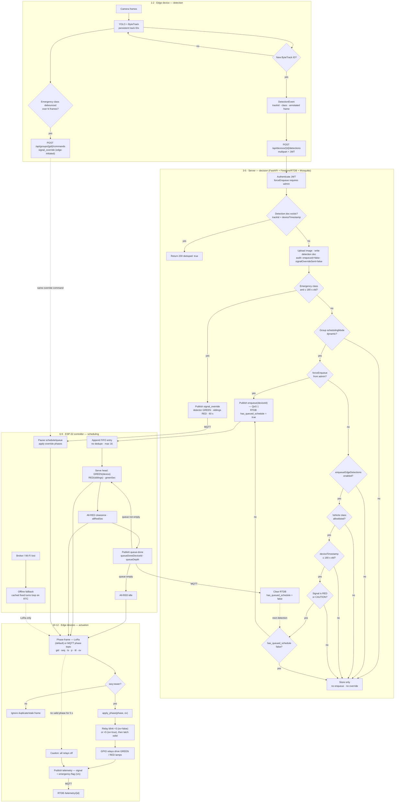
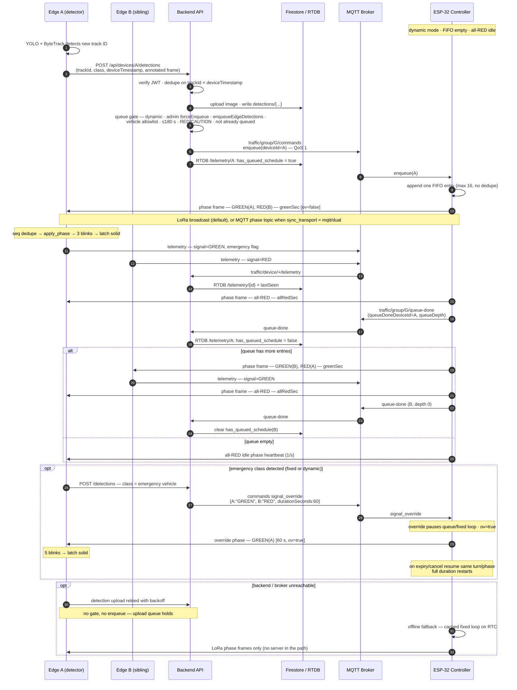

# Detection to Actuation

This page follows a single vehicle detection through the whole control loop: an **edge device** detects and uploads it over REST, the **backend** decides whether it may queue it, the **ESP-32 controller** schedules the phase, and the **edge devices** actuate their relays. It covers the normal dynamic-queue path, emergency overrides, fixed-mode behavior, and what remains when the server is unreachable.

The loop has four hops:

| Hop | Transport | Payload |
| --- | --------- | ------- |
| Edge → Server | `POST /api/devices/{id}/detections` (HTTPS, JWT multipart) | `trackId`, `class`, `deviceTimestamp`, annotated frame |
| Server → Controller | MQTT `traffic/group/{gid}/commands` (QoS 1) | `enqueue` or `signal_override` |
| Controller → Edge | LoRa broadcast (default) or MQTT `traffic/group/{gid}/phase` | phase frame `{gid, seq, ts, p, ttl, ov}` |
| Edge → Server | MQTT telemetry / `queue-done` | lean signal + emergency flag; queue completion |

Two invariants matter throughout:

- Detections travel over **REST**, not MQTT, and only **new** documents run the queue gate. Telemetry never triggers an enqueue.
- The edge device does not know group mode, queue state, or `enqueueEdgeDetections`. It detects, uploads, and actuates whatever phase frame it receives.

## End-to-End Flowchart

**Reading the stages**

1. **Detection (1-2):** ByteTrack assigns a persistent ID; the first sighting emits one detection event with the annotated frame. Separately, an emergency-class vehicle debounced over consecutive frames can trigger an edge-initiated override request.
2. **Decision (3-5):** The backend authenticates, dedupes, stores the detection, and either publishes an emergency override, publishes an `enqueue`, or stores only.
3. **Scheduling (6-9):** The controller appends the entry to its FIFO, serves it as GREEN for `greenSec`, clears with all-RED for `allRedSec`, then reports `queue-done`.
4. **Actuation (10-12):** Every edge in the group receives the same phase frame, dedupes it by `seq`, blinks the requested lamps (3 normally, 5 during an override), latches solid, and reports lean telemetry.

## End-to-End Sequence Diagram

## Path Variants

| Path | Trigger | Server | Controller | Edge |
| ---- | ------- | ------ | ---------- | ---- |
| Dynamic queue | New allowlisted vehicle detection, group `dynamic`, signal RED/CAUTION, not already queued | Publish `enqueue`, set RTDB flag | Serve FIFO head GREEN for `greenSec`, then all-RED for `allRedSec`, publish `queue-done` | 3 blinks, latch solid |
| Admin force-enqueue | `forceEnqueue=true` from an admin, group `dynamic` | Skips `enqueueEdgeDetections` and the allowlist/staleness/signal/already-queued checks | Same FIFO serve (duplicates allowed) | 3 blinks |
| Detections disabled | Group `enqueueEdgeDetections: false` | Store only | Untouched | Unchanged |
| Fixed mode | `schedulingMode: "fixed"` | Store only; `enqueue` is never sent | Runs the cached turns loop | 3 blinks per turn |
| Emergency | `class` matches the emergency allowlist and detection is ≤ 180 s old | Publish `signal_override` (detector GREEN, siblings RED, 60 s); ignores mode and `enqueueEdgeDetections` | Pauses queue/turn loop, broadcasts override phases with `ov=true` | 5 blinks, latch solid |
| No bound controller | Emergency on a device with no group or no `controllerId` | Publish device-level `signal_override` with `targetSignal: "GREEN"` | Not involved | Applies the device command |
| Server / broker offline | Internet loss | No gate, no enqueue; edge uploads retry | Cached fixed turns loop on RTC, LoRa only | Receives phases over LoRa; MQTT-only groups enter caution |
| Phase loss | No valid frame for 5 s | — | — | All relays off (caution) |

## Timing and Safety Notes

- **Staleness:** 180 s for both the emergency and queue gates. Stale offline retries are stored but never queue or override.
- **Queue capacity:** 16 entries. The controller appends every `enqueue` exactly once; duplicates and the currently-GREEN device are served in order.
- **Queue dedupe:** `has_queued_schedule` is a per-device boolean, not a per-entry counter, so a duplicate forced entry can still be pending when the first `queue-done` clears it.
- **Override duration:** `durationSeconds` `0` is indefinite, positive is a fixed duration, negative is rejected. Overrides live in RAM only and are lost on controller reboot.
- **Resume:** after expiry or cancel, the controller resumes the same turn or interrupted queue phase, but restarts its full duration.
- **Phase frames:** the controller sends a 1 s heartbeat and a burst of 3 packets with the same `seq` on every phase change. Edge devices dedupe by `seq`; `ov` selects 3 vs 5 blinks (missing `ov` defaults to `false`).
- **Offline caveat:** with `sync_transport: mqtt`, there is no LoRa fallback. Without broker connectivity the edge sees no valid phase and enters caution after the 5 s timeout.
- **Emergency dual paths:** the backend reaction above is primary. The edge may also POST `signal_override` to `/api/groups/{id}/commands` directly (admin credentials, 60 s cooldown); if both fire, the controller receives an identical duplicate override.

## Related Pages

- [Architecture](architecture.md) — components and communication modes
- [Edge Device](edge-device.md) — video pipeline, tracking, and relay actuation
- [Traffic Controller](traffic-controller.md) — FIFO, overrides, and offline state machine
- [Backend API](backend-api.md) — detection endpoint and gate pseudocode
- [MQTT Communication](mqtt-communication.md) — topics and phase sync transport
