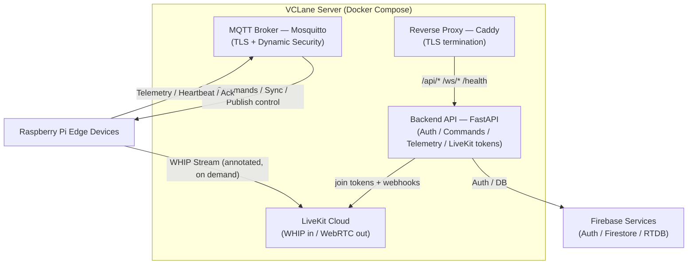
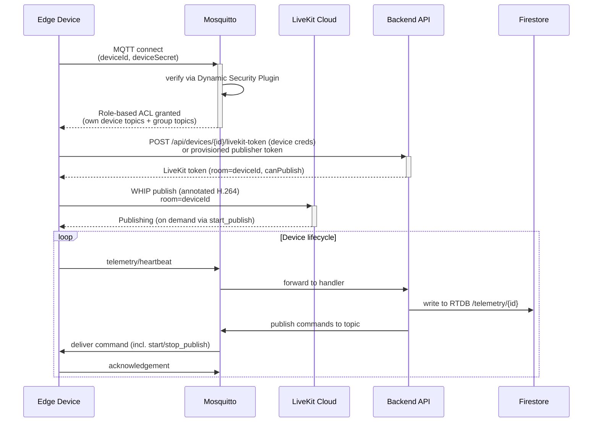

# Server Integration

The VCLane server is a Docker Compose stack of three services — Caddy, Backend (FastAPI), and Mosquitto — plus managed LiveKit Cloud for video. The stack manages edge devices and real-time communication; LiveKit fans out annotated WHIP streams to viewers. (MediaMTX deprecated since 2.11.0, kept for backward compat.)

## Backend API

The backend acts as the centralized management and coordination layer between users, edge devices, and cloud services.

### Architecture



### Responsibilities

- User authentication
- Device registration
- Device management
- Traffic monitoring
- Telemetry processing
- Signal override handling
- Intersection grouping
- Traffic synchronization
- MQTT command publishing
- Firebase synchronization

### Technology Stack

| Component            | Technology                          |
| -------------------- | ----------------------------------- |
| Programming Language | Python                              |
| Backend Framework    | FastAPI                             |
| API Architecture     | REST API + WebSocket                |
| MQTT Integration     | Paho MQTT Client                    |
| MQTT Broker          | Mosquitto                           |
| Authentication       | Firebase Admin SDK + JWT + bcrypt   |
| Database             | Firestore                           |
| Real-Time Telemetry  | Realtime Database                   |
| Media Server         | LiveKit Cloud (WHIP / WebRTC)       |
| Reverse Proxy        | Caddy                               |
| API Documentation    | OpenAPI / Swagger                   |
| Containerization     | Docker + Docker Compose             |
| Deployment           | Linux Server / Cloud Infrastructure |

### Key Features

**Device Management** — Register edge devices, manage device configurations, track device status, monitor device health, assign devices to intersections.

**Traffic Monitoring** — Receive real-time telemetry, monitor traffic conditions, store traffic information, generate traffic statistics, detect traffic events.

**Traffic Control** — Send traffic signal commands, trigger manual overrides, manage intersection schedules, coordinate multiple intersections, process command responses.

**Real-Time Synchronization** — MQTT command publishing, device heartbeat processing, WebSocket client updates, event notifications.

## Backend ↔ LiveKit (managed SFU)

LiveKit Cloud handles all media fan-out. The backend never proxies video — it mints short-lived join tokens and reacts to webhooks for on-demand publishing. (MediaMTX HTTP auth callback `GET /api/mediamtx/auth` deprecated since 2.11.0, kept for backward compat.)

### Configuration

```env
LIVEKIT_URL=wss://vclane.livekit.cloud
LIVEKIT_API_KEY=...
LIVEKIT_API_SECRET=...
```

### Auth Flow

1.  **Viewer:** mobile app calls `POST /api/devices/{id}/livekit-token` with operator JWT → backend returns LiveKit token `{room: deviceId, identity: userId, canSubscribe: true}`. App joins via `livekit_client`.
2.  **Publisher:** edge Pi fetches its publisher token at register/run (or uses a backend-minted token via MQTT-provisioned secret) → `FFmpeg WHIP POST` to `LIVEKIT_URL` with `room=deviceId, identity=deviceId, canPublish: true`.
3.  **On-demand:** `POST /api/livekit/webhook` receives `participant_joined/left` → backend publishes `{"command": "start_publish" | "stop_publish", "payload": {}}` to `traffic/device/{id}/commands`. Pi idles with no FFmpeg/WHIP until `start_publish`.

No shared RTSP credentials. Tokens expire quickly; room is per-device (`room=deviceId`).

### Publish Format

When a device is provisioned, it receives a LiveKit room name equal to `deviceId`:

```
room: {deviceId}, identity(publisher): {deviceId} via WHIP (H.264 baseline, 720p, 2 s GOP)
```

- Annotation is burned in on the Pi (`OpenCV → YOLO+ByteTrack → draw → FFmpeg stdin → WHIP`) — LiveKit carries the annotated frames opaquely, transcode-free.
- Viewers join the same `room=deviceId` as subscribers only.

---

## Backend ↔ MQTT (Mosquitto)

The backend connects to Mosquitto as an internal MQTT client to receive telemetry from devices and publish commands.

### Connection

- Client ID: `vclane-backend`
- Host: `mosquitto:1883` (internal Docker network, no TLS)
- Password: `vclane-backend` — matches the admin client bootstrapped in the Dynamic Security config
- The `admin` role grants access to all traffic topics plus `$CONTROL/dynamic-security/#` for Dynamic Security administration

### Subscriptions

On connect, the backend subscribes to six wildcard topics plus the Dynamic Security response topic:

| Topic Pattern                       | Handler                   | Destination                                                                                                |
| ----------------------------------- | ------------------------- | ---------------------------------------------------------------------------------------------------------- |
| `traffic/device/+/telemetry`        | `_handle_telemetry`       | Writes to RTDB at `/telemetry/{deviceId}` — injects `online: true` and `lastSeen` (no queue gate)          |
| `traffic/device/+/heartbeat`        | `_handle_heartbeat`       | Same as telemetry (no queue gate)                                                                          |
| `traffic/device/+/goodbye`          | `_handle_goodbye`         | Sets `online: false` on `/telemetry/{deviceId}`                                                            |
| `traffic/device/+/acknowledgements` | `_handle_ack`             | Logs the payload — no persistence or callback                                                              |
| `traffic/group/+/queue-done`        | `_handle_queue_done`      | Processes controller `queueDoneDeviceId` → clears `has_queued_schedule`                                    |
| `traffic/group/+/prepare-response`  | _(no handler)_            | Subscribed but not processed                                                                               |

All inbound handlers parse the topic to extract `deviceId` (third segment) and route accordingly.

### Publish (Outbound)

| Trigger                           | Topic                          | Payload                                                                              |
| --------------------------------- | ------------------------------ | ------------------------------------------------------------------------------------ |
| `POST /api/devices/{id}/commands` | `traffic/device/{id}/commands` | `{"command": "...", "payload": {...}}`                                               |
| `POST /api/devices/{id}/signal`   | `traffic/device/{id}/commands` | `{"command": "signal_override", "payload": {"targetSignal": "..."}}`                 |
| `POST /api/groups/{id}/commands`  | `traffic/group/{id}/commands`  | `{"command": "signal_override", "payload": {"phases": {...}, "durationSeconds": N}}` |
| `POST /api/groups/{id}/sync`      | `traffic/group/{id}/prepare`   | `{"deviceIds": ["id1", "id2", ...]}`                                                 |
| Dynamic queue gate (auto)         | `traffic/group/{gid}/commands` | `{"command": "enqueue", "payload": {"deviceId": "..."}}`                             |

---

## Backend ↔ Edge Devices (via MQTT)

### Device Provisioning Flow

1. Admin calls `POST /api/devices` (JWT required) with `{deviceId, name, location}`.
2. Backend generates a device secret: `vcl-{32 hex chars}`.
3. Secret is bcrypt-hashed and stored in Firestore at `devices/{deviceId}.deviceSecretHash`.
4. LiveKit room is `room={deviceId}` (publisher joins via WHIP with a backend-minted token). RTSP URL is still constructed as `rtsp://{deviceId}@mediamtx:8554/{deviceId}` for backward compat (deprecated since 2.11.0).
5. Mosquitto user is created via two Dynamic Security RPCs: `publish_dynsec("createClient", ...)` to create the MQTT client, then `publish_dynsec("addClientRole", ...)` to assign the `device` role.
6. Response returns `{deviceId, deviceSecret, rtspUrl, livekitRoom}` — the plaintext secret is only returned once. `rtspUrl` is deprecated since 2.11.0 but kept for backward compat.

### Device Authentication (End-to-End)



### Command Formats

**Signal override** (published on device creation or via `POST /api/devices/{id}/signal`):

```json
{
  "command": "signal_override",
  "payload": {
    "targetSignal": "green"
  }
}
```

The backend also writes a Firestore document to `signalOverrides/{id}` with `{deviceId, targetSignal, requestedBy, status: "active", requestedAt, expiresAt}` (expires in 1 hour). Expiration is not enforced by the backend — the edge device is expected to honor it.

**Group command (signal override / cancel)** — published on `POST /api/groups/{id}/commands` to `traffic/group/{id}/commands`:

```json
{ "command": "signal_override", "payload": { "phases": { "device-001": "GREEN", "device-002": "RED" }, "durationSeconds": 30 } }
{ "command": "cancel_override", "payload": {} }
```

`durationSeconds <= 0` is indefinite. The ESP-32 controller pauses its schedule turn-loop while an override is active and uses the override phases in its place; on expiry/cancel it resumes the same turn it paused on but restarts that turn's full duration from the beginning — remaining time is not preserved.

**Queue enqueue (dynamic mode)** — published automatically by the queue gate to `traffic/group/{groupId}/commands`:

```json
{ "command": "enqueue", "payload": { "deviceId": "intersection-01" } }
```

**Group sync** (published on `POST /api/groups/{id}/sync`):

```json
{
  "deviceIds": ["intersection-01", "intersection-02"]
}
```

Edge devices in the group respond on `traffic/group/{groupId}/prepare-response`.

### Dynamic Queue Gate (per-group `schedulingMode: "dynamic"`)

No new topics — the gate triggers off `POST /api/devices/{id}/detections` (new docs only). Telemetry no longer triggers enqueue.

**On `POST /api/devices/{deviceId}/detections` (new doc, not `deduped:true`):**

```
group = Firestore lookup via devices/{deviceId}.groupId (already resolved)
if group.schedulingMode != "dynamic": return  # fixed path: store only
if payload.class not in vehicle allowlist: return  # detections are unfiltered; pedestrians must not queue
if now - deviceTimestamp > ~30s: return           # stale (offline retry burst) → store only, no queue
state = RTDB /telemetry/{deviceId}            # {currentTrafficLightSignal, has_queued_schedule}
if state.currentTrafficLightSignal != "RED": drop   # already GREEN → already served
if state.has_queued_schedule == true: drop          # dedup pending/ongoing request
else:
    publish {"command": "enqueue", "payload": {"deviceId"}} to traffic/group/{groupId}/commands
    RTDB update /telemetry/{deviceId}: {has_queued_schedule: true, queuedAt: now}
```

**On `traffic/group/{groupId}/queue-done` with `queueDoneDeviceId`:**

```
RTDB update /telemetry/{queueDoneDeviceId}: {has_queued_schedule: false, queuedAt: null}
```

When the controller's FIFO empties it broadcasts all-RED; no backend action is needed for the idle state.

---

## MQTT Topic Reference

| Direction            | Topic                                  | Publisher         | Consumer                      | Payload                                                                               |
| -------------------- | -------------------------------------- | ----------------- | ----------------------------- | ------------------------------------------------------------------------------------- |
| Device → Backend     | `traffic/device/{id}/telemetry`        | Edge device       | Backend (→RTDB)               | Lean telemetry JSON (signal + emergency flag; no counts, no queue trigger) |
| Device → Backend     | `traffic/device/{id}/heartbeat`        | Edge device       | Backend (→RTDB)               | Arbitrary JSON                                                                        |
| Device → Backend     | `traffic/device/{id}/acknowledgements` | Edge device       | Backend (logged)              | Arbitrary JSON                                                                        |
| Device → Backend     | `traffic/group/{id}/prepare-response`  | Edge device       | Backend (unhandled)           | Arbitrary JSON                                                                        |
| Controller → Backend | `traffic/group/{id}/schedule-request`  | ESP-32 controller | Backend                       | Empty (on connect)                                                                    |
| Controller → Backend | `traffic/group/{id}/queue-done`        | ESP-32 controller | Backend (queue clear)         | `queueDoneDeviceId`, `queueDepth`                                                     |
| Controller → Backend | `traffic/group/{id}/heartbeat`         | ESP-32 controller | Backend                       | Uptime + timestamp JSON                                                               |
| Backend → Controller | `traffic/group/{id}/schedule`          | Backend           | ESP-32 controller             | Schedule JSON (turns loop + schedulingMode + dynamicConfig)                           |
| Backend → Controller | `traffic/group/{id}/commands`          | Backend           | ESP-32 controller             | `{"command": str, "payload": {}}` (`signal_override` / `cancel_override` / `enqueue`) |
| Backend → Device     | `traffic/device/{id}/commands`         | Backend           | Edge device                   | `{"command": str, "payload": {}}`                                                     |
| Backend → Devices    | `traffic/group/{id}/prepare`           | Backend           | Edge devices in group         | `{"deviceIds": [str]}`                                                                |

### Mosquitto Dynamic Security

Mosquitto uses the **Dynamic Security Plugin** instead of static ACL files. Two roles are bootstrapped at image build:

- **`admin`** — assigned to `vclane-backend`, grants read/write on all `traffic/device/+/#` and `traffic/group/+/#` topics plus CONTROL topics.
- **`device`** — applied per device, grants read/write on `traffic/device/%u/#` and `traffic/group/+/#` topics.

#### RPC Format

Dynamic Security commands are sent as MQTT RPCs on `$CONTROL/dynamic-security/v1`. The payload must wrap the command in a `commands` array:

```json
{
  "commands": [
    {
      "command": "createClient",
      "username": "intersection-01",
      "password": "vcl-abc123...",
      "textname": "intersection-01"
    }
  ]
}
```

A single `"command"` key at the top level (without the `commands` array) will cause an `"Unknown command"` / `"Invalid/missing commands"` error on Mosquitto 2.1.2.

Success responses omit both `"success"` and `"error"` keys — only the response fields (e.g., `"clients"` for `listClients`). Failure responses include an `"error"` key.

#### Provisioning Flow

When a device is provisioned via `POST /api/devices`, the backend sends **two** RPCs:

1. `createClient` — registers the MQTT client with username/password
2. `addClientRole` — assigns the `device` role to the newly created client

On deprovisioning (`DELETE /api/devices/{id}`), a single `deleteClient` RPC removes the client and its role assignments.

#### Docker Volume Persistence

The `mosquitto_data` Docker volume at `/mosquitto/data` in the container persists the Dynamic Security database file (`dynamic-security.json`) across container restarts. To apply a fresh image config (e.g., after rebuilding with new roles/ACLs), the volume must be deleted:

```bash
docker compose down mosquitto
docker volume rm vclane-server_mosquitto_data
docker compose up -d mosquitto
```

---

## Integration API Endpoints

| Method   | Path                           | Auth     | Purpose                          | Side-Effect                                                      |
| -------- | ------------------------------ | -------- | -------------------------------- | ---------------------------------------------------------------- |
| `POST`   | `/api/devices`                 | JWT      | Create device + provision secret | `add_mosquitto_user()` via Dynamic Security RPC                  |
| `DELETE` | `/api/devices/{id}`            | JWT      | Delete device                    | `remove_mosquitto_user()` via Dynamic Security RPC               |
| `POST`   | `/api/devices/{id}/commands`   | JWT      | Send arbitrary command           | MQTT publish to `traffic/device/{id}/commands` (incl. `start_publish` / `stop_publish`) |
| `POST`   | `/api/devices/{id}/signal`     | JWT      | Override traffic signal          | MQTT publish + Firestore write                                   |
| `POST`   | `/api/devices/{id}/detections` | JWT      | Submit per-vehicle detection     | Storage upload + Firestore `detections` write (no MQTT, no RTDB) |
| `POST`   | `/api/groups/{id}/sync`        | JWT      | Trigger group prepare            | MQTT publish to `traffic/group/{id}/prepare`                     |
| `POST`   | `/api/devices/{id}/livekit-token` | JWT   | Mint LiveKit join token          | Returns `{token, room, url}`; no MQTT/RPC side-effect            |
| `POST`   | `/api/livekit/webhook`         | LiveKit  | LiveKit webhook receiver         | Publishes `start/stop_publish` to `traffic/device/{id}/commands` |
| `GET`    | `/api/mediamtx/auth`           | _(none)_ | MediaMTX auth callback (deprecated since 2.11.0, kept for backward compat) | Reads Firestore, bcrypt verify |
